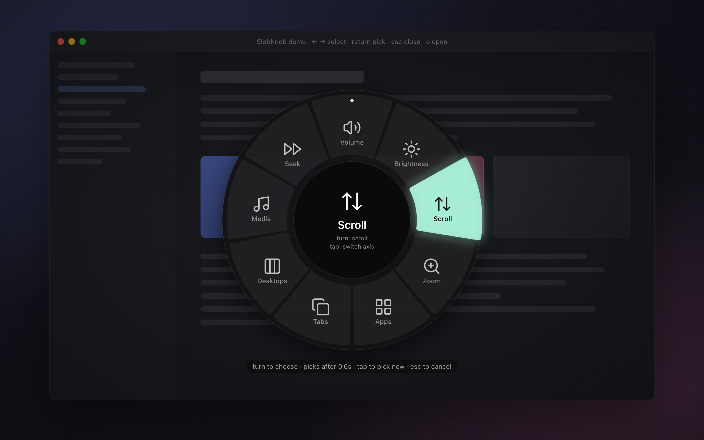
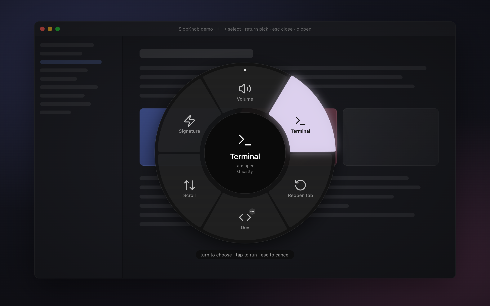
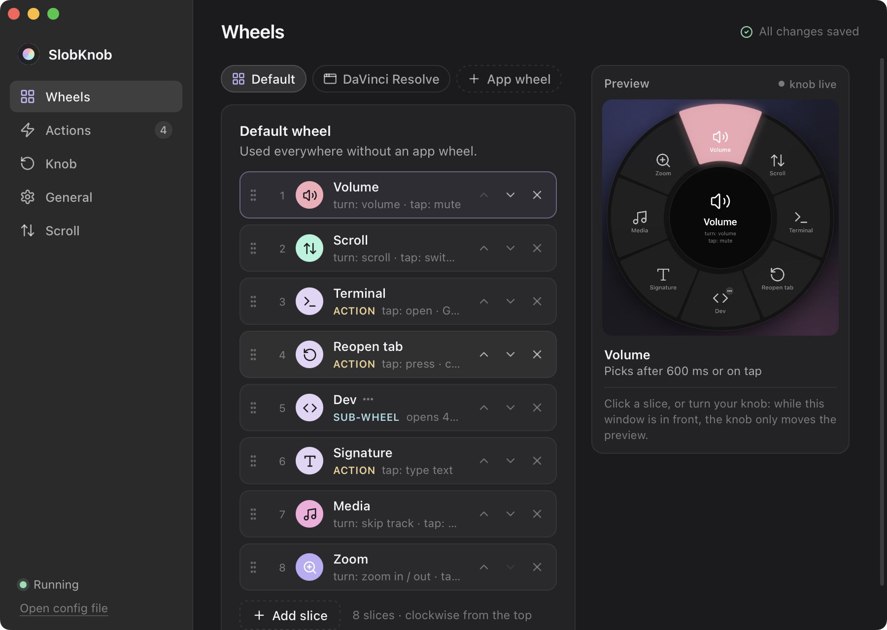
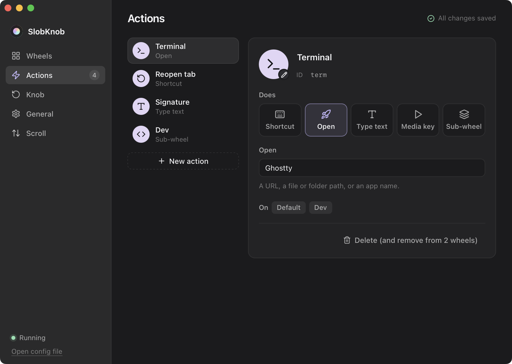
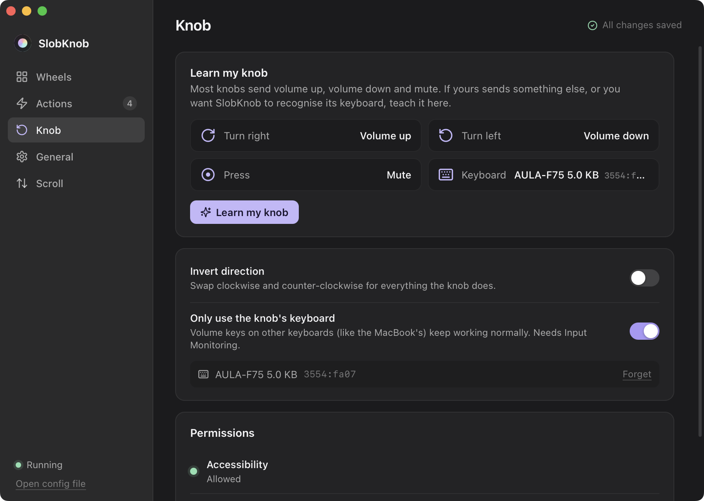

# SlobKnob

Turn your keyboard's volume knob into a GTA-style weapon wheel for your whole computer.

Double-tap the knob (or hold Cmd / Win and turn), spin to a mode, and the knob now scrolls, zooms,
switches apps, tabs or desktops, skips or seeks music, steps frames in DaVinci Resolve, or runs your own
shortcuts. Built for the AULA F75; works with any knob that sends volume up / down / mute.



## Your own slices

Slices can also run something once: press a shortcut, open an app or link, type a snippet, or open a
sub-wheel with more slices.



## Settings

Edit wheels and actions with a live preview that follows the real knob, teach SlobKnob what your knob
sends, and keep your laptop's own volume keys working.





## What's in here

```
app/          The cross-platform app (Rust + Tauri). See app/README.md.
              Build: npm install && npx tauri build   (needs Rust and Node)
              Run without UI: cargo run -p knob-platform --example knobcli

hammerspoon/  The earlier Hammerspoon version for macOS.
              Install: copy init.lua, knobwheel.lua and knobwheel-icons/ into ~/.hammerspoon/,
              install Hammerspoon (brew install --cask hammerspoon), grant it Accessibility,
              then Reload Config.
              Pause / resume:  open -g "hammerspoon://knobwheel?action=pause"   (or resume)
```

Status: macOS works; Windows runs and works with a real AULA F75, with a few features still unconfirmed
(see app/README.md).
